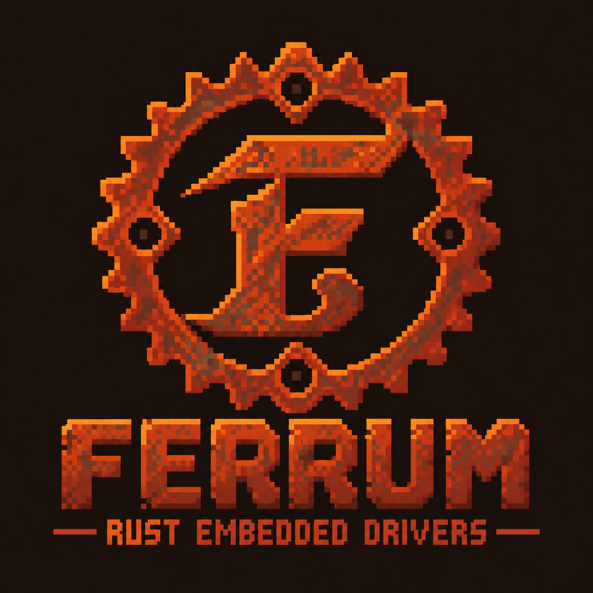

<p align="center">
  
</p>

<h1 align="center">Ferrum Drivers</h1>

<p align="center"><em>Small drivers. Real hardware. Rust.</em></p>

<p align="center">
  
  
  
</p>

## What is Ferrum Drivers?

Ferrum Drivers is an experimental collection of embedded Rust drivers. Its
core idea is to keep **hardware-independent sensor and protocol logic**
separate from **microcontroller-specific code**.

That split makes it a good place to:

- **Learn embedded Rust on real hardware**, one small sensor at a time.
- **Reuse a protocol implementation** across different microcontrollers.
- **Explore** `no_std`, hardware abstraction traits, GPIO, timing, and
  communication protocols.
- **Build and experiment incrementally.** Not every driver is finished, and
  none should be assumed ready for critical use.

## Getting started — choose your board

You don't need prior microcontroller experience. You need:

- a supported board (below),
- a DHT11 temperature and humidity sensor,
- a USB cable, and
- a pull-up on the sensor's DATA line (some DHT11 modules already include one).

| Board | MCU / target | Sensor | Platform crate | Example | DATA pin |
|---|---|---|---|---|---|
| Raspberry Pi Pico 2 | RP2350 / `thumbv8m.main-none-eabihf` | DHT11 | `ferrum-rp2350` | `pico2_dht11` | GPIO15 |
| Seeed XIAO ESP32-C3 | RISC-V ESP32-C3 / `riscv32imc-unknown-none-elf` | DHT11 | `ferrum-esp32` | `esp32c3_dht11` | GPIO3 (D1) |

Both boards have working firmware examples and developer-reported physical
validation.

Next steps: follow the [DHT11 guide](docs/dht11.md) for wiring and usage, and
the [Development Runbook](docs/runbooks/development.md) for setup,
compilation, and flashing.

## Supported drivers

| Driver | Core implementation | Platform adapters | Physically validated | Status |
|---|---|---|---|---|
| [`ferrum-dht11`](crates/ferrum-dht11) | Yes | RP2350, ESP32-C3 | Pico 2, XIAO ESP32-C3 (developer-reported) | Experimental |
| [`ferrum-nrf24`](crates/ferrum-nrf24) | Blocking `embedded-hal` 1.0 driver | None | Pico 2 W ↔ XIAO ESP32-C3 (developer-reported, documented configuration) | Experimental |

`ferrum-nrf24` provides synchronous SPI operations, explicit radio lifecycle
management, polling reception, and no-acknowledgment transmission. Its
documented physical validation covers radio initialization and bidirectional
FER–RUM communication on one Pico 2 W / XIAO ESP32-C3 configuration; it does
not establish long-term reliability or broad radio compatibility. It has no
platform adapters or async backend. See the
[crate documentation](crates/ferrum-nrf24/README.md) and
[nRF24 hardware audit](docs/audits/ferrum-nrf24.md) for details and
limitations.

## Architecture — one protocol, multiple platforms

Ferrum Drivers separates hardware-independent protocols from platform-specific
integrations.

```text
        crates/ferrum-dht11
   (DHT11 protocol, no_std, hardware-independent)
          ▲                         ▲
          │                         │
  platforms/rp2350          platforms/esp32
  (RP2350 GPIO + timer)     (ESP32-C3 GPIO + timer)
          │                         │
     Raspberry Pi Pico 2      Seeed XIAO ESP32-C3
```

- **`crates/ferrum-dht11`** implements the DHT11 protocol against small
  hardware traits, so it never touches a specific chip.
- **`platforms/rp2350`** and **`platforms/esp32`** connect that protocol to
  real pins and timers, and hold the firmware examples.

`no_std` means the code does not rely on an operating system or the standard
library, which is what makes it suitable for microcontrollers.

Each platform is its own Cargo workspace because chip-specific toolchains,
targets, and dependencies differ and should not leak into the core drivers.

[ADR-001: Platform-Oriented Workspaces](docs/adr/001-platform-oriented-workspaces.md)
is the authoritative document for architecture, rationale, and development
rules.

## Your first sensor reading

This snippet targets the **Raspberry Pi Pico 2** and runs on the board, not on
your computer. It assumes the RP2350 clocks, GPIO pins, and `TIMER0` have
already been initialized, as in the full example.

```rust
use ferrum_rp2350::dht11::Dht11;

let mut sensor = Dht11::new(pins.gpio15, timer);
let measurement = sensor.read().await?;

// Both integer and decimal parts are transmitted by the sensor.
// measurement.humidity_integer, measurement.humidity_decimal,
// measurement.temperature_integer, measurement.temperature_decimal
```

The ESP32-C3 adapter is similar: `Dht11::new(peripherals.GPIO3)`. Allow at
least two seconds between reads. For complete, buildable firmware, see
[`platforms/rp2350/examples/pico2_dht11.rs`](platforms/rp2350/examples/pico2_dht11.rs)
and
[`platforms/esp32/examples/esp32c3_dht11.rs`](platforms/esp32/examples/esp32c3_dht11.rs).

## Documentation

- [DHT11 — Temperature & Humidity](docs/dht11.md)
- [nRF24 hardware validation audit](docs/audits/ferrum-nrf24.md)
- [ADR-001: Platform-Oriented Workspaces](docs/adr/001-platform-oriented-workspaces.md)
- [Development Runbook](docs/runbooks/development.md)
- [DHT11 technical audit](docs/audits/ferrum-dht11.md): implementation
  limitations and engineering review

## Development

Ferrum Drivers uses separate Cargo workspaces for hardware-independent drivers
and platform integrations.

From the repository root, verify the host-side drivers with:

```sh
cargo test --workspace
```

RP2350 and ESP32 builds must be run from `platforms/rp2350` and
`platforms/esp32` respectively. The
[Development Runbook](docs/runbooks/development.md) is the authoritative source
for build, test, flash, and debugging commands.

## Project maturity and limitations

Ferrum Drivers is experimental and under active development. That is simply
where the project honestly is today:

- Hardware validation is developer-reported and limited to specific boards and
  configurations. It shows successful operation, not calibration or long-term
  stability.
- The current DHT11 async API performs blocking delays and pulse polling during
  a read.
- The [audit](docs/audits/ferrum-dht11.md) identifies outstanding work on
  timing validation, data-bit pulse checks, and test coverage.
- APIs may change.

## Contributing and learning

Curious about embedded Rust, driver development, or hardware experiments?
Small contributions are welcome: testing on your own hardware, improving
documentation, adding tests, or asking questions that reveal unclear
explanations. Opening an issue or pull request is a good way to start.

## License

Licensed under `MIT OR Apache-2.0`, as declared in the Cargo manifests. See
[LICENSE-MIT](LICENSE-MIT) and [LICENSE-APACHE](LICENSE-APACHE).