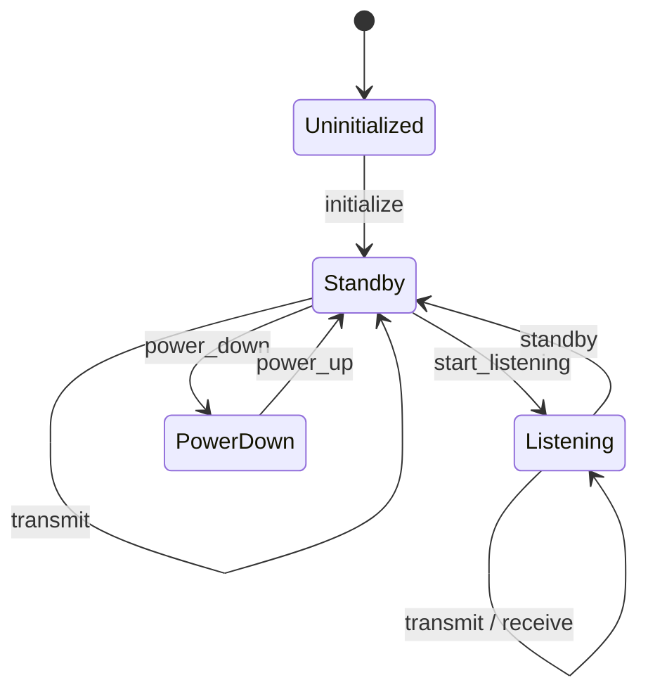

# ADR-002: nRF24 Driver Architecture

- **Status:** Proposed
- **Date:** 2026-10-29
- **Scope:** nRF24 driver architecture and platform integration

## Context

Ferrum Drivers separates portable protocol drivers from platform-specific
hardware integrations. This ADR records the architecture and implementation
history for the portable `ferrum-nrf24` crate.

The migration starting point, `nrf24-driver` in the `metro-simulation-engine`
workspace, uses `embedded-hal` 1.0 and `no_std` with synchronous SPI. It
initializes into RX mode, automatically transitions RX → TX → RX for
transmission, polls STATUS for TX completion, supports dynamic payloads of
1–32 bytes, and currently transmits using NO_ACK. It does not use IRQ and
maintains a conservative `Faulted` error state. These are characteristics of
the starting implementation, not commitments for the Ferrum API.

The objective is to migrate and evolve this driver without coupling the core
crate to a particular MCU or async executor, while keeping beginner use
straightforward and advanced radio control explicit.

## Current implementation status (2026-10-30)

The blocking backend is implemented in software. This status does not indicate
that physical hardware has been validated.

**Implemented:**

- Blocking SPI backend using `embedded-hal` 1.0.
- Initialization and explicit radio lifecycle with Standby, Listening,
  PowerDown, and Faulted states.
- Dynamic RX payload handling.
- Single-payload `W_TX_PAYLOAD_NOACK` transmission.
- Successful TX restores the previous stable state.
- Current fail-stop error policy: once TX mode has been entered, any TX or
  restoration failure leaves the driver Faulted, even if restoring the prior
  hardware mode succeeds.

FEATURE access is checked by writing and reading back the configured bits.
Because ACTIVATE (`0x50, 0x73`) toggles feature-register access, initialization
sends it once only when the probe fails, then retries the FEATURE write. It
does not issue ACTIVATE unconditionally.

**Not yet implemented:**

- Async polling backend.
- Async IRQ backend.
- Platform-specific integrations.
- Physical hardware validation.

## Decision

### Accepted architectural decisions

#### One driver, multiple execution backends

Use one nRF24 core driver with internally separated execution backends and
shared configuration, register definitions, and applicable state-management
logic. The planned execution modes are:

- **Blocking:** synchronous SPI and polling.
- **Async Poll:** asynchronous SPI, cooperative polling, and asynchronous
  delays.
- **Async IRQ:** asynchronous SPI and interrupt-driven event notification via
  the nRF24L01+ IRQ pin.

These are execution mechanisms for the same transceiver, not separate hardware
drivers. All backends follow the same logical radio-state contract wherever
applicable. The design remains compatible with `no_std` and does not impose an
async executor on the portable driver.

Do not add generic abstraction frameworks, unnecessary traits, or separate
internal crates without demonstrated need.

#### Platform-oriented feature selection

Consumers select driver support through a platform crate, consistent with
[ADR-001](001-platform-oriented-workspaces.md), rather than selecting
sensor- or radio-specific crates as their primary platform interface. The
intended ESP32 feature interface is conceptually:

```toml
ferrum-esp32 = {
    version = "0.1",
    features = [
        "nrf24",
        "nrf24-async-poll",
        "nrf24-async-interrupt",
    ]
}
```

These feature identifiers are intended names, subject to normal repository
consistency checks; they are not implemented by this ADR. Platform-facing
feature selection is separate from the core driver's internal backend
architecture. This ADR does not add or modify Cargo features.

#### Hybrid interaction model

Provide a beginner-oriented high-level API and an explicit-control API.
High-level operations manage required mode transitions automatically.
Successful `transmit()` restores the stable operational state that preceded
transmission: Standby → TX → Standby or Listening → TX → Listening.
Transmission from Power Down is rejected rather than silently waking the
radio. Do not add a configuration flag such as `rx_after_tx`.

The explicit-control API lets callers request Standby-I, Listening (RX),
Power Down, and Power Up (returning to Standby-I). The driver remains
responsible for register writes, CE control, hardware timing, and safe
transitions; callers are not required to implement electrical signaling.
Expose meaningful radio operations, not every internal register.

#### Incremental implementation

Develop the backends in order: Blocking, then Async Poll, then Async IRQ. Do
not implement all three simultaneously. Establish behavior, errors, and tests
for the blocking backend before beginning async work.

### Proposed implementation contracts

The following initial software state model and behavior guide Phase 1. They
require validation against the hardware implementation and do not specify
every internal nRF24L01+ hardware state.

Logical states:

- `Uninitialized`
- `Standby` (Standby-I)
- `Listening`
- `PowerDown`
- `Faulted`

`Transmitting` may be a transient internal operation, not a persistent public
state.

| Operation | Initial state | Successful final state |
|---|---|---|
| `initialize()` | Uninitialized | Standby |
| `start_listening()` | Standby | Listening |
| `standby()` | Listening | Standby |
| `power_down()` | Standby | PowerDown |
| `power_up()` | PowerDown | Standby |
| `transmit()` | Standby | Standby |
| `transmit()` | Listening | Listening |
| `receive()` | Listening | Listening |

Initialization is intended to configure and verify the radio, power it up,
and leave it in Standby-I with CE low. A convenience initializer that starts
listening may be considered, but its API is not accepted here. Requests from
incompatible states should be rejected without hardware I/O. The
state-preserving `receive()` entry describes the intended state contract; its
waiting behavior remains open.



Power management is available in every backend and distinguishes Power Down
(minimum-power transceiver state), Standby-I (powered and configured, not
listening or transmitting), and Listening (receiver active). The driver
controls transceiver power states, not MCU sleep policies. MCU sleep, wake-up
sources, and executor idle behavior belong to the application and platform
HAL. Do not add hidden inactivity timers, automatic Power Down behavior, or
undocumented state changes. Async execution does not guarantee lower power
consumption.

### Open questions

Resolve each question during the implementation phase where it first becomes
necessary; do not settle internal details prematurely.

- Exact public API names, signatures, and types.
- How much implementation logic can be shared across synchronous and
  asynchronous SPI traits.
- Whether advanced TX batching or persistent PTX control is needed.
- Async future cancellation and hardware-state recovery.
- IRQ synchronization, event handling, and timeout policy.
- Detailed error classification and recovery from `Faulted`.
- Additional power-management convenience APIs.
- Policies for redundant or unsupported state transitions.
- Whether receiving should include a waiting API in addition to immediate FIFO
  polling.

## Consequences

**Benefits**

- Consistent radio semantics across execution backends.
- A beginner-friendly high-level API without denying advanced explicit
  control.
- Predictable and explicit transceiver power management.
- Incremental development with existing migration tests as a baseline.

**Trade-offs**

- Multiple backends increase testing and maintenance requirements.
- Shared synchronous and asynchronous logic may be limited by different HAL
  traits.
- Explicit modes add state-transition cases.
- Async cancellation and IRQ operation require additional correctness
  guarantees.

## Implementation and validation

1. **Blocking:** Migrate and stabilize synchronous functionality, implement
   the logical state model and hybrid API, and preserve and extend the
   existing unit tests. The blocking backend is implemented and its software
   checks are performed in the crate; hardware validation remains pending.
2. **Async Poll:** Add asynchronous SPI and cooperative polling, define
   cancellation safety before async transmission, and validate independently
   from the blocking backend.
3. **Async IRQ:** Add IRQ-driven notification and handle pending events,
   STATUS inspection, timeouts, and races. This phase requires additional
   hardware integration because the current setup does not have IRQ wired.

Existing mock tests do not establish RF delivery or physical compatibility.
Validate blocking behavior first; test Async Poll and Async IRQ independently.
Hardware-in-the-loop validation is desirable, especially for IRQ, timing, and
power behavior. Power-consumption claims require measurement, not assumptions.

## Error-state guarantee

Successful operations must leave the radio in their documented final logical
state. Validation failures occurring before hardware I/O preserve the previous
state. In the blocking implementation, hardware-operation failures fault the
driver when the resulting state cannot be reliably established. Once TX mode
has been entered, every transmission or restoration failure leaves the driver
Faulted even if the previous hardware mode was successfully restored; callers
must establish safe hardware conditions before reusing a faulted instance.
